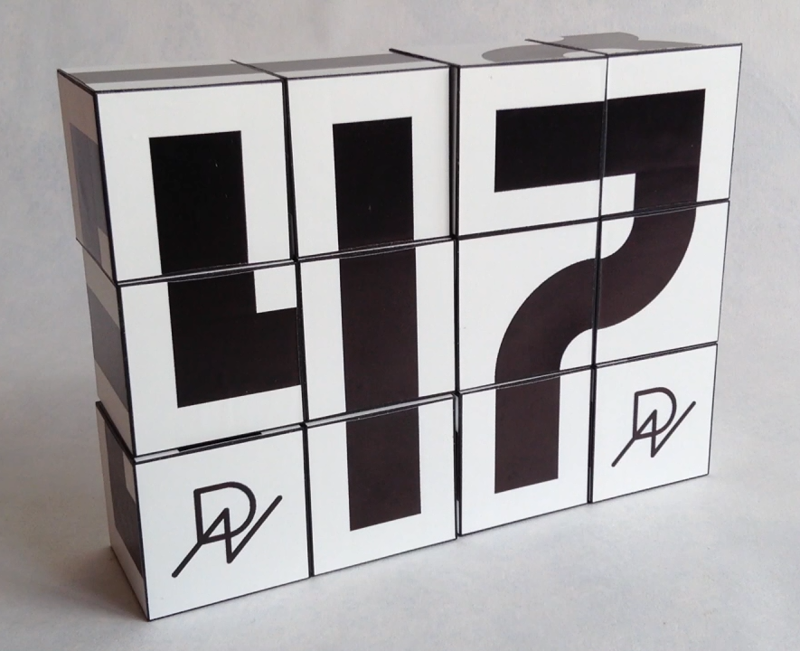

# Text Cubes: A Modular Testing Environment for Computer Vision & Robotics

**Text Cubes is an open-source robotic testing environment and a physical matrix text system based on a proprietary universal modular code.** 

By moving away from traditional typographic standards, the project introduces an unconventional method of text layout and graphic construction. It deliberately breaks established linguistic and formatting traditions in a structured, logical way—creating a new tradition of machine-readable typography. This layout challenges traditional reading mechanics but remains fully decodable, ensuring uninterrupted recognition by both Artificial Intelligence/Computer Vision (CV) agents and humans.

The physical implementation eliminates standard redundant character sets. Instead, it relies on universally interchangeable modules to assemble texts, complex vector graphics, or geometric compositions.

---

## The MVP Prototype

Below is the physical Minimum Viable Product (MVP) of the system, demonstrating the real-world scale, high-contrast markers, and the unique layout mechanics that challenge and train computer vision models:



---

## Core Concept & Machine-Human Convergence

Standard text recognition systems rely heavily on classic font geometry, making them fragile when encountering unexpected spatial breaks or severe compression. **Text Cubes establishes a new norm** by transforming text from smooth curves into a rigid, rectangular matrix.

### Key Features:
* **Tradition-Breaking Layouts:** Text flows, vertical orientation shifts, and unconventional segmentations challenge standard Optical Character Recognition (OCR). This forces AI agents to learn spatial topology rather than memorizing static shapes.
* **Unified Graphical Language:** The same physical modules used to write algorithmic phrases can seamlessly shift into a complex spatial graphic (such as a 3D animal profile or an inverted matrix pattern) without altering the underlying hardware.
* **Zero-Redundancy Architecture:** Unlike traditional block toys where specific letters go unused and lead to a massive waste of physical space, every single side of the cube is actively utilized.
* **Hardware Branding Baseline:** The 6th side of the module is reserved for an integrated logo marker, serving as an anchor point for robotic grippers and an orientation baseline for external camera calibration.

---

## Repository Structure

```text
├── /.github                # Repository configuration files
├── /hardware               # 3D models and manufacturing specs
│   ├── /stl                # STL files ready for 3D printing
│   └── /step               # STEP files for industrial manufacturing (acrylic/milling)
├── /documentation          # Conceptual and architectural whitepapers
│   └── ARCHITECTURE.md     # Mathematical parameters and grid layout rules
└── README.md               # Main project showroom
```

---

## Applications

1. **Computer Vision Calibration:** A highly predictable, high-contrast physical environment to test Edge Computing vision nodes, camera focus, and spatial distortion.
2. **Robotic Manipulator Testing:** An ideal sandbox for sorting algorithms, pick-and-place routines, and physical puzzle-solving agents.
3. **Smart Supermarket Shelves & PR:** Kinetic installations where robotic systems or users dynamically assemble promotional text and generative art without screens, ink, or electricity.
4. **Decentralized AI Environments:** A tangible communication protocol designed to interface natively with distributed digital twins and autonomous robotic capsule systems.

---

## Getting Started

To implement this modular testing environment in your own robotics lab:

---

1. Navigate to the `/hardware/stl` directory.
2. Download the base module models.
3. 3D-print a test starter kit (recommended material: high-contrast black and white PLA or polished colored acrylic).
4. Review `documentation/ARCHITECTURE.md` to program the character assembly rules into your vision system.

---


---


---


---


---


---


---


---


---


---

